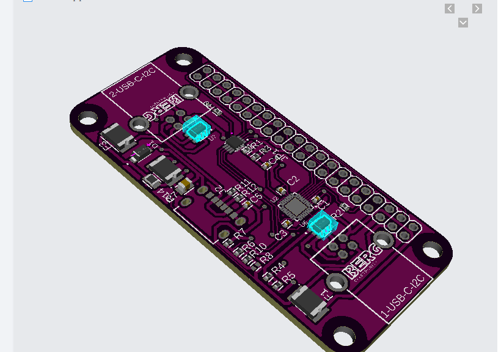
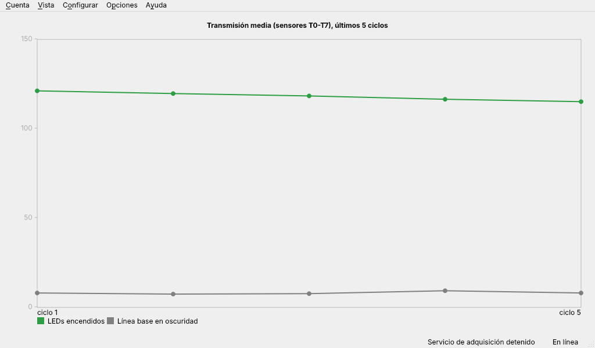
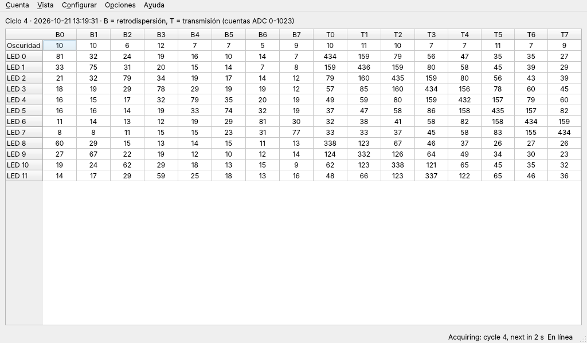
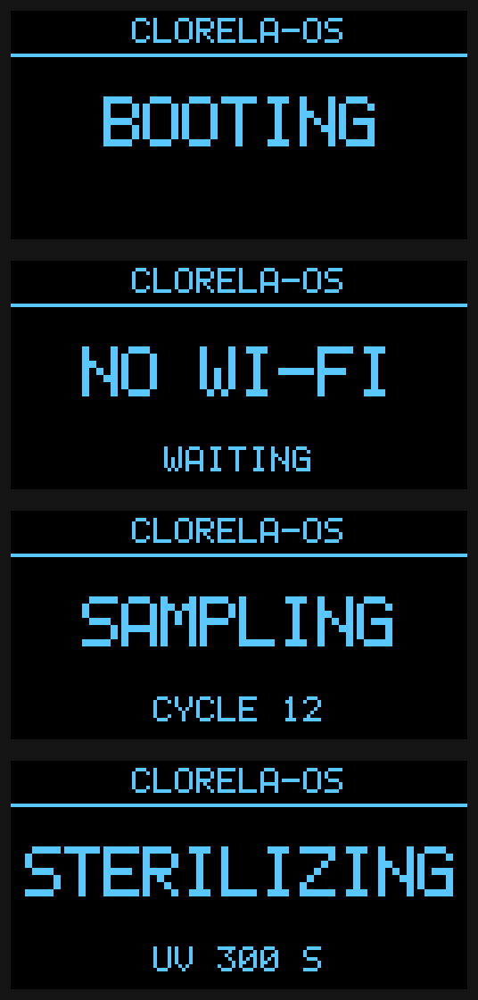
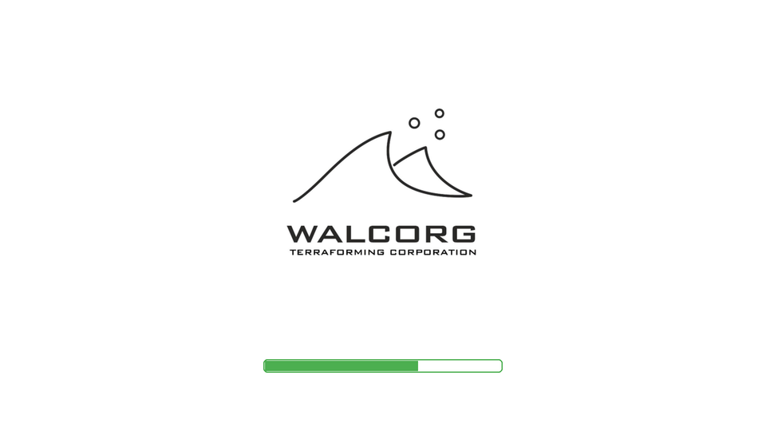

# Clorela-OS

**Clorela-OS** is the embedded Linux system of the **WALCORG** photobioreactor node. It runs on a Raspberry Pi Zero W fitted with the WALCORG shield. It drives one or two nodes, each a 1-litre cube holding a living culture of the microalga *Chlorella vulgaris* that captures CO2, and it measures the cultures with light.

The node shines LEDs through the culture and reads how much light comes back with photoresistors. From those readings Clorela-OS follows how the culture grows. The same LEDs can also write any text into the culture as light, one ASCII character at a time, and the culture's optical "answer" can be recorded. Between cultures, UVC LEDs sterilize the empty cube.

Clorela-OS is the piece that will let a node prove its CO2 capture and turn it into **Codosin (CO2in)** tokens on Polygon, through the [Anchor Protocol](https://github.com/walcorg/anchor-protocol).

> **Status: under development.** The interface, the acquisition service, the status display and the signing hook build and are tested on a PC with a simulated node. The Yocto layer for the Pi Zero W image (`meta-clorela`, with the WALCORG boot splash) passes BitBake's full parse; its first complete build is pending on the build server. See [What works today](#what-works-today) and [`CHANGES.md`](CHANGES.md).

<p align="center">
  
  &nbsp;
  
</p>
<p align="center"><em>Left: node v4.5 (1 L cube). Right: shield v4 for the Raspberry Pi Zero W.</em></p>

## Contents

- [How the node works](#how-the-node-works)
  - [Measuring the culture with light](#measuring-the-culture-with-light)
  - [Writing text into the culture: 8-LED ASCII encoding](#writing-text-into-the-culture-8-led-ascii-encoding)
  - [UVC sterilization](#uvc-sterilization)
- [System overview](#system-overview)
- [What works today](#what-works-today)
- [Install Clorela-OS on a microSD card](#install-clorela-os-on-a-microsd-card)
- [Using Clorela-OS](#using-clorela-os)
- [Troubleshooting the Raspberry Pi Zero](#troubleshooting-the-raspberry-pi-zero)
- [Build and run on a PC](#build-and-run-on-a-pc)
- [Build the image (Yocto)](#build-the-image-yocto)
- [Configuration](#configuration)
- [Repository layout](#repository-layout)
- [Roadmap](#roadmap)
- [FAQ](#faq)
- [Related repositories](#related-repositories)
- [License](#license)

## How the node works

Each node is a transparent 1 L cube (10 × 10 × 10 cm) with a flexible PCB on its inner walls. The PCB carries the LEDs and the light sensors. A rigid PCB on top carries an **Arduino Nano**, which runs the [`walcorg/node-routine`](https://github.com/walcorg/node-routine) firmware and obeys the commands Clorela-OS sends over I2C.

| Part | Quantity | Role |
|---|---|---|
| Data LEDs (visible) | 8 | One bit each; together they show one byte (one ASCII character) |
| Calibration LEDs (visible) | 4 | Extra light sources for calibration and measurements |
| **UVC LEDs (275 nm)** | 4 | Sterilize the empty cube between cultures |
| **Photoresistors** | 16 | 8 on the **backscatter** wall (B0–B7) and 8 on the **transmission** wall (T0–T7) |
| TLC59401 | 1 | 16-channel constant-current LED driver |
| CD74HC4067 | 1 | 16:1 analog multiplexer that brings the 16 photoresistors to the Arduino's ADC |
| Arduino Nano | 1 per node board | Runs the measurements; I2C slave at 0x10–0x13 (solder jumpers) |

### Measuring the culture with light

A measurement is a reading of all 16 photoresistors as 10-bit values (0–1023) while a known set of LEDs is on:

- **Transmission (T0–T7).** Light that crosses the culture and reaches the opposite wall. The denser the culture, the more light it absorbs, so transmission **drops as the algae grow**.
- **Backscatter (B0–B7).** Light reflected back by the cells towards the LED wall. It **rises** with biomass.
- **Dark baseline.** The same reading with every LED off. It tells the noise floor apart from real light and **detects light leaking** into the cube (the node raises a `DARK_ALERT` flag).

Each acquisition cycle of Clorela-OS (every 60 s by default) runs a dark reading and then turns on each of the 12 visible LEDs on its own, one after another, recording all 16 sensors each time. That gives 13 × 16 values per node per cycle, stored locally. The interface shows them as a trend (**Graph** view) and as a table (**Numeric** view).

### Writing text into the culture: 8-LED ASCII encoding

The 8 data LEDs form one byte: **LED *i* shows bit *i***, with LED 0 as the least significant bit. Any ASCII character can therefore be "written" as light. A text is sent one character at a time, and after each character the node measures all 16 photoresistors.

Example: `W` is ASCII 0x57 = `0101 0111`, so LEDs 0, 1, 2, 4 and 6 turn on.

```
Text   "WALCORG"
Char   W         A         L         C         O         R         G
Hex    0x57      0x41      0x4C      0x43      0x4F      0x52      0x47
LEDs   76543210  76543210  76543210  76543210  76543210  76543210  76543210
       01010111  01000001  01001100  01000011  01001111  01010010  01000111
```

Light from each pattern crosses the living culture before it reaches the sensors, so the sequence of readings is an optical response of that culture to that text. The idea dates back to node v4.3. It is the basis of the **optical challenge** in the Anchor Protocol: the network sends a challenge, the node "writes" it into the culture, and the recorded response helps show that a real culture is being measured rather than replayed data.

The firmware exposes two commands for this (see [node-routine](https://github.com/walcorg/node-routine#i2c-protocol)):

| Command | What it does |
|---|---|
| `K, byte` | Shows one byte on LEDs 0–7, waits for the light to settle, **measures the 16 sensors** and keeps the pattern on |
| `B, speed, text` | **Plays** up to 29 characters on LEDs 0–7, at a chosen speed in ms per character. Demo mode only: no measurement |

Clorela-OS already stores this kind of reading (record type `byte`). The encoding routine itself, including the challenge format, is still to be defined and is listed in the [Roadmap](#roadmap).

### UVC sterilization

Four 275 nm UVC LEDs disinfect the empty cube between cultures. The firmware enforces the safety rules itself, whatever the host asks:

- The maximum duration is **30 minutes**, fixed in the firmware. The default is 5 minutes.
- Turning UVC on switches the visible LEDs off.
- While UVC is active the node accepts only **stop** (`F`) and **safe mode** (`D`). Both interrupt it immediately.
- A 2 s watchdog resets the Arduino with the UVC LEDs and their 9 V boost converter off if the firmware hangs.

While a node is sterilizing, Clorela-OS skips it in the acquisition cycles, shows **STERILIZING** and the remaining seconds on the shield display, and stops any running acquisition first.

> ⚠️ **UVC light (275 nm) damages eyes and skin.** Sterilize only an **empty** node with the **lid closed**. Never look at the LEDs while they are on.

## System overview

```
                 HDMI monitor                     0.96" OLED on the shield
                      ▲                                     ▲
┌─────────────────────┼─────────────────────────────────────┼──────────┐
│ Raspberry Pi Zero W │  Clorela-OS (Yocto Linux)           │          │
│                     │                                     │          │
│   clorela-ui ───────┘   menus, Graph/Numeric views        │          │
│      │  local socket (start / stop / status)              │          │
│      ▼                                                    │          │
│   clorela-acqd ── cycles ──▶ SQLite (read by clorela-ui)  │          │
│      │   └── status messages ─────────────────────────────┘          │
│      │   └── Signer (TROPIC01, future) ── signs capture receipts     │
└──────┼───────────────────────────────────────────────────────────────┘
       │ I2C (3.3 V)
┌──────▼───────────── Shield v4 ───────────────────────────────────────┐
│ PCA9306 level shifter → I2C 5 V on USB-A ports, 500 mA per node      │
│ TROPIC01 on SPI0 · USB-C power input · 2-port USB hub (FE1.1s)       │
└──────┬───────────────────────────────────────────────┬───────────────┘
       │ USB-A cable: +5 V, I2C (D− = SDA, D+ = SCL)    │
   Node 1 (Arduino Nano + LEDs + 16 photoresistors)  Node 2
```

| Program | What it does |
|---|---|
| `clorela-ui` | Full-screen Qt 6 interface on the HDMI output. Menus carried over from the original design, Graph and Numeric views, Spanish, English and French |
| `clorela-acqd` | Acquisition service, independent of the interface. Talks to the nodes over I2C, runs the cycles, stores the readings in SQLite and drives the status display. Can run against a **simulated node** when there is no hardware |
| `clorela-status` | Writes a message on the shield display. Used at boot to show **BOOTING** |
| `Signer` | Extension point for the TROPIC01 secure element that will sign capture receipts. Today it reports "not available". See [`docs/signer-tropic01.md`](docs/signer-tropic01.md) |

The shield hardware is documented in [`docs/hardware-shield-v4.md`](docs/hardware-shield-v4.md). That page covers the schematic, the pinout and what the software depends on.

## What works today

| Capability | Node firmware | Clorela-OS |
|---|---|---|
| Dark reading + one reading per LED, every cycle | ✅ | ✅ `clorela-acqd`, stored in SQLite |
| Graph and Numeric views, ES/EN/FR, full screen | — | ✅ `clorela-ui` |
| Start / stop acquisition (F1 / F5) | — | ✅ |
| Restricted mode without Wi-Fi | — | ✅ the interface can be browsed; acquisition waits for Wi-Fi |
| Status display (BOOTING, SAMPLING, STERILIZING…) | — | ✅ SSD1306 driver; display not yet on the shield schematic |
| UVC sterilization | ✅ | ✅ in the service (control socket); ⏳ no menu item yet |
| 8-LED ASCII encoding (`K`, `B`) | ✅ | ⏳ record type ready; routine and challenge format to define |
| Calibration (`C`) | ✅ | ⏳ |
| TROPIC01 signing | — | ⏳ interface only |
| Log in, profile, wallet address, server, updates, problem reports | — | ⏳ menu items present, windows not implemented |
| Boot splash on HDMI (WALCORG logo + progress bar) | — | ✅ psplash in `meta-clorela`; ⏳ to check on hardware |
| Wi-Fi from a file on the boot partition | — | ✅ `wpa_supplicant.conf` imported on first boot |
| Yocto image for the Pi Zero W | — | ✅ layer parses and resolves; ⏳ first full build on the R710 |

## Install Clorela-OS on a microSD card

This follows WALCORG's *Tutorial 1/5: How to install Clorela-OS on a microSD* ([PDF](docs/tutorials/1-of-5-install-clorela-os-on-a-microsd.pdf)). The tutorial was written for the 2021 alpha image; the steps are the same for the new image. The full guide, with notes, is in [`docs/flashing.md`](docs/flashing.md).

> **Image availability.** Images built from this repository will be published under [Releases](https://github.com/walcorg/clorela-os/releases) as `clorela-image-raspberrypi0-wifi.rootfs.wic.xz`, with a SHA-256 checksum, after the first image is built and tested on hardware. You can also build it yourself: [Build the image](#build-the-image-yocto). The alpha image on [walcorg.com](https://walcorg.com) → DOWNLOADS (`core-image-sato`, 2021) is legacy and does not contain the software in this repository.

**You need:** a Raspberry Pi Zero W, a branded microSD card (SanDisk or Panasonic recommended), a card reader, a good 5.1 V / 3 A power supply and a computer with internet access.

1. **Download the image.** Get the Clorela-OS image (see above) and save it on your computer.
2. **Install Raspberry Pi Imager.** Download it from <https://www.raspberrypi.com/software/> for Windows, macOS or Ubuntu, then run the installer. On Raspberry Pi OS you can instead run `sudo apt install rpi-imager`.
3. **Insert the microSD card** into the computer, either directly or through an adapter or card reader.
4. **Open Raspberry Pi Imager** and click **CHOOSE OS**.
5. Scroll to the bottom of the list and click **Use custom**.
6. **Select the Clorela-OS image** you downloaded and click **Open**. The image name now appears on the button where CHOOSE OS was.
7. Click **CHOOSE STORAGE** and select **your microSD card**. Check the size carefully so you do not pick another drive.
8. Click **WRITE** and wait until writing and verification finish.
9. Remove the microSD card from the computer and **insert it into the Raspberry Pi Zero W**.

**First boot.** Connect the shield and the HDMI monitor, then power the Pi through the shield's USB-C input. The monitor shows the WALCORG splash with a progress bar, the shield display shows **BOOTING** and then **READY**, and the interface opens full screen. Without Wi-Fi it starts in **restricted mode**. To connect it, put a `wpa_supplicant.conf` with your network name and password on the card's boot partition before the first boot, as described in [`docs/flashing.md`](docs/flashing.md#wi-fi). The **Configure → Configure Wi-Fi** window is not implemented yet.

## Using Clorela-OS

### Menus

The menu tree is the one designed for Clorela-OS v14 (see [`docs/legacy-v14.md`](docs/legacy-v14.md)).

| Menu | Item | What it does | Needs Wi-Fi |
|---|---|---|---|
| **Account** | Log in / Log out | Session with the WALCORG platform ⏳ | yes |
| | My profile → User data, Wallet address | Account details and the wallet that receives Codosin ⏳ | yes |
| | **Start acquisition (F1)** / **Stop acquisition (F5)** | Starts or stops the measurement cycles | start: yes |
| **View** | Display → **Graph** / **Numeric** | Trend of the last cycles / table of the latest cycle | no |
| | Language → English, Español, Français | Changes the language immediately; remembered after reboot | no |
| **Configure** | Configure Wi-Fi | Connects the node to a network ⏳ | no |
| | Configure server | Platform server address ⏳ | no |
| **Options** | Check for updates · Connection properties | ⏳ | updates: yes |
| **Help** | About Clorela-OS · About WALCORG | Version and project information | no |
| | Report a problem | Sends a report to WALCORG ⏳ | yes |

⏳ = menu item present, window not implemented yet.

### Reading the views

- **Graph** shows, for the last 60 cycles, the mean transmission (T0–T7) with the LEDs on (green) and the dark baseline (grey). A slowly falling green line means the culture is getting denser.
- **Numeric** shows the latest cycle as a table with one row per reading (Dark, LED 0 … LED 11) and one column per sensor (B0–B7 backscatter, T0–T7 transmission). The values are raw ADC counts, from 0 to 1023.
- The **status bar** shows the acquisition state (for example "Acquiring: cycle 12, next in 34 s") and whether the node is online.

| Graph view | Numeric view |
|---|---|
|  |  |

*Screenshots taken with the simulated node.*

### Status display on the shield



| Message | Meaning |
|---|---|
| **BOOTING** | Clorela-OS is starting |
| **READY** | Started, acquisition stopped; second line shows Wi-Fi state |
| **SAMPLING** | Acquisition running; second line shows the last cycle |
| **NO WI-FI** | Acquisition was started but is waiting for Wi-Fi |
| **STERILIZING** | A node is in UVC sterilization; second line shows seconds left |
| **NODE ERROR** | No node answered in the last cycle (check the cable and the address jumpers) |
| **STOPPED** | The acquisition service was shut down |

<br clear="right">

### Sterilizing a node

Until the interface has a menu item for this, send the command to the acquisition service from a terminal on the node, for example with `socat`:

```bash
# 300 s (5 min) of UVC on every configured node (1-1800 s allowed)
echo '{"cmd":"sterilize","seconds":300}' | socat - UNIX-CONNECT:/run/clorela/acqd.sock
# stop it early
echo '{"cmd":"stop_uv"}' | socat - UNIX-CONNECT:/run/clorela/acqd.sock
```

Remember: **empty node, lid closed.**

## Troubleshooting the Raspberry Pi Zero

Raspberry Pi boards are tested before they leave the factory, so a faulty board is rare. The usual causes are:

| Symptom | Likely cause and fix |
|---|---|
| No light at all on the Pi | Almost always the **microSD card is not detected**. Unlike other models, the Pi Zero shows no light without a readable card. Re-seat it; try another card or write the image again |
| Random crashes or reboots | **Poor power supply.** Use a good 5.1 V / 3 A supply; avoid computer USB ports |
| Fails to boot or corrupts files | **Cheap or "no name" microSD card**, or a corrupted card. Use SanDisk or Panasonic and write the image again |
| Green LED blinks 3, 4 or 7 times, repeatedly | Boot files missing or damaged on the card (3 = `start.elf` not found, 4 = `start.elf` damaged, 7 = kernel not found). **Write the image again** |
| Green LED blinks 8 times, repeatedly | **SDRAM not detected.** Write the image again first; if it persists, the Pi itself is likely damaged |
| Screen works but the shield display stays blank | Display address or bus not matching the configuration; see `[display]` in [Configuration](#configuration) |
| **NODE ERROR** on the display | Node cable unplugged, or two node boards with the same address jumpers |

More details: [`docs/flashing.md`](docs/flashing.md).

## Build and run on a PC

You can develop and test on a PC: the acquisition service runs against a **simulated node** that answers like the real firmware.

**Requirements (Ubuntu 24.04 or newer):**

```bash
sudo apt install cmake ninja-build g++ qt6-base-dev qt6-tools-dev qt6-tools-dev-tools \
                 qt6-l10n-tools libqt6sql6-sqlite libgl-dev
```

**Build and test:**

```bash
cmake -S . -B build -G Ninja
cmake --build build
ctest --test-dir build --output-on-failure
```

**Run with the simulated node** (two terminals, from the repository root):

```bash
./build/src/acqd/clorela-acqd --config data/dev.conf            # starts sampling every 10 s
./build/src/ui/clorela-ui    --config data/dev.conf --windowed
```

Data goes to `run-dev/`. Other useful options:

- `clorela-ui --language en|es|fr`
- `--view graph|numeric`
- `--screenshot file.png`
- `clorela-status --pbm out.pbm SAMPLING "CYCLE 12"` renders a display frame to an image.

Build options: `-DCLORELA_BUILD_UI=OFF`, `-DCLORELA_BUILD_ACQD=OFF` and `-DCLORELA_BUILD_TESTS=OFF`. The acquisition service never links Qt Gui.


## Build the image (Yocto)

The image is built with Yocto Project 5.0 "Scarthgap" (LTS) and [kas](https://kas.readthedocs.io), with every layer pinned to a commit. In short, on a Linux build server (WALCORG uses a Dell PowerEdge R710 with 12 GB of RAM):

```bash
pipx install kas                       # plus the Yocto host packages, see docs/building.md
mkdir -p ~/yocto && cd ~/yocto
git clone https://github.com/walcorg/clorela-os.git
kas build clorela-os/kas/clorela.yml:clorela-os/kas/r710.yml
# -> build/tmp/deploy/images/raspberrypi0-wifi/clorela-image-raspberrypi0-wifi.rootfs.wic.xz
```

The full guide covers host packages, the Ubuntu 26.04 and memory notes, the container alternative, rebuilding after code changes, what `meta-clorela` contains and what still has to be checked on the hardware: [`docs/building.md`](docs/building.md).

The image boots with the WALCORG splash on HDMI (1920×1080) and a progress bar driven by systemd:

<p align="center">
  
</p>

## Configuration

`/etc/clorela/clorela.conf` (INI) is read by both programs at start-up. The commented default is [`data/clorela.conf`](data/clorela.conf); [`data/dev.conf`](data/dev.conf) is for a PC.

| Section | Key | Default | Meaning |
|---|---|---|---|
| `[acquisition]` | `sensor` | `i2c` | `i2c` (real nodes) or `sim` (simulated node) |
| | `i2c_bus` | `1` | Node I2C bus number **[TO VERIFY]**, see [hardware notes](docs/hardware-shield-v4.md) |
| | `node_addresses` | `0x10` | Node boards to read (0x10–0x13) |
| | `interval_s` | `60` | Seconds between cycles |
| | `leds` | `0-11` | LEDs measured one by one each cycle |
| | `require_network` | `true` | Acquisition waits for Wi-Fi |
| | `autostart` | `false` | Start sampling when the service starts |
| `[display]` | `backend` | `ssd1306` | `ssd1306`, `console` or `none` |
| | `i2c_bus`, `address` | `1`, `0x3C` | Display bus and address **[TO VERIFY]** |
| `[signer]` | `backend` | `none` | Secure element; only `none` exists today |
| `[ui]` | `fullscreen`, `language` | `true`, `es` | Interface defaults |
| `[storage]` | `database` | `/var/lib/clorela/measurements.db` | Local SQLite database |

## Repository layout

| Path | Contents |
|---|---|
| `src/ui/` | `clorela-ui`: main window, views, translations (`translations/*.ts`) |
| `src/acqd/` | `clorela-acqd`: node protocol, simulated node, acquisition cycle, control socket |
| `src/status/` | Shield display driver (SSD1306) and `clorela-status` |
| `src/signer/` | TROPIC01 signing extension point |
| `src/common/`, `src/hw/` | Configuration, SQLite store, network check, Linux I2C access |
| `tests/` | Unit tests (QtTest) |
| `data/` | Default and development configuration |
| `docs/` | Hardware, flashing guide, signer notes, legacy v14 notes, images, tutorial PDF |
| `meta-clorela/` | Yocto layer: distro, image, application recipe, systemd units, boot splash, `config.txt` |
| `kas/` | Pinned layer set (`clorela.yml`), build-server limits (`r710.yml`), development additions (`debug.yml`) |
| `data/branding/` | WALCORG logo used by the boot splash |

## Roadmap

- **First image build and hardware test** on the R710; publish `wic.xz` releases with checksums.
- **Grow the root partition** to the whole microSD card on first boot.
- **ASCII encoding routine** in `clorela-acqd`: text or challenge → `K` per character → stored responses. This will be the basis of the Anchor Protocol optical challenge.
- **Sterilization and calibration** items in the interface, with safety confirmations.
- **Account, Wi-Fi, server and update windows** behind the existing menus.
- **TROPIC01 signer** and capture receipts for the [Anchor Protocol](https://github.com/walcorg/anchor-protocol).
- **Shield v4.1** decisions: I2C multiplexer per node port, TROPIC01 chip select, display on the schematic.
- **Network check** that confirms the WALCORG server is reachable, not only a default route.

## FAQ

**What is Clorela-OS?**
It is the software that runs the WALCORG node. Its goal is to let you convert the CO2 your culture captures into tokens called **Codosin (CO2in)**, through the Anchor Protocol on Polygon.

**Is there a physical version of the token?**
Yes: a physical Codosin collector coin, sold by WALCORG (see the tutorial PDF).

**How was Clorela-OS made?**
A video series in Spanish shows the creation process: <https://youtu.be/jvU4fKmdEkM>.

**Can I use Clorela-OS without internet?**
Yes, in restricted mode: you can browse the interface, change the view and language and configure Wi-Fi. Acquisition and anything that talks to the platform need Wi-Fi.

## Related repositories

- [`walcorg/node-routine`](https://github.com/walcorg/node-routine): Arduino Nano firmware of the node and its I2C protocol.
- [`walcorg/anchor-protocol`](https://github.com/walcorg/anchor-protocol): hardware-anchored issuance of Codosin.
- [`walcorg/software-ciwi`](https://github.com/walcorg/software-ciwi): firmware of the CiWi cold wallet.
- [`walcorg/clorela_os_v14`](https://github.com/walcorg/clorela_os_v14): the original interface sketch.

## License

[MIT](LICENSE) © 2026 WALCORG TERRAFORMING CORP.

Maintained by WALCORG · [walcorg.com](https://walcorg.com)
