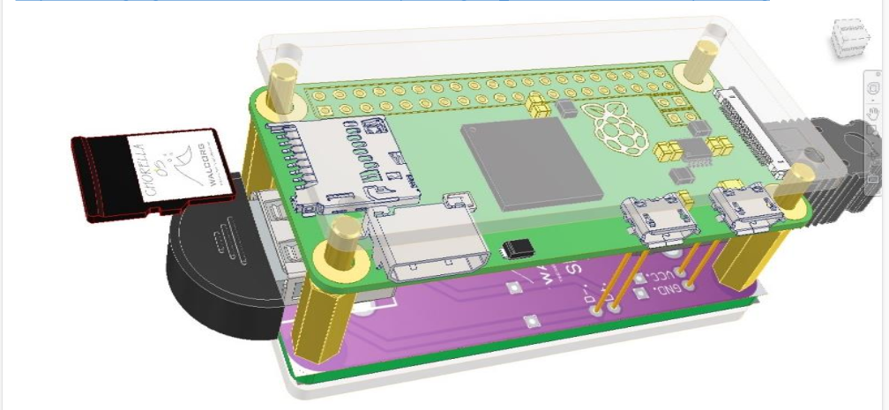

# Shield v4 for the Raspberry Pi Zero W

The WALCORG shield sits on the Raspberry Pi Zero W running Clorela-OS. It connects the Pi to up to two photobioreactor nodes over I2C and powers them. It also carries the TROPIC01 secure element and adds two USB host ports. It is designed in Autodesk Fusion and manufactured and assembled by JLCPCB.

> **Status:** the schematic below is the current shield v4 design. The I2C status display (0.96" 128x64 OLED, SSD1306) will be added and is **not in the schematic yet**. Pin and bus facts on this page come from the schematic; anything not yet checked on an assembled board is marked **[TO VERIFY]**.

*Shield v4 PCB, JLCPCB 3D preview.*

*3D model of the earlier **shield v3** under a Raspberry Pi Zero, in an enclosure. It is shown for illustration only and does not match v4 exactly.*

## Schematic

| Circuit | Function | Image |
|---|---|---|
| 1 | PCA9306 I2C level shifter: Pi I2C1 (3.3 V) ↔ node bus (5 V); 4.7 kΩ pull-ups on the 5 V side | [circuit-1](images/schematic/circuit-1-i2c-level-shifter.jpg) |
| 2 | Per-node protection: USBLC6-2SC6 ESD on SDA/SCL, 500 mA PTC (MF-MSMF050-2) on each node's +5 V | [circuit-2](images/schematic/circuit-2-node-protection.jpg) |
| 3 | USB-C power input (sink, 5.1 kΩ on CC1/CC2), resettable fuse, SMF5.0A TVS, +5 V rail | [circuit-3](images/schematic/circuit-3-usb-c-power-input.jpg) |
| 4 | 40-pin GPIO header and TROPIC01 secure element on SPI0 | [circuit-4](images/schematic/circuit-4-gpio-header-tropic01.jpg) |
| 5 | Dual USB-A port to the nodes: I2C carried on the data pins (D− = SDA, D+ = SCL), 100 Ω series resistors | [circuit-5](images/schematic/circuit-5-node-ports.jpg) |
| 6 | Dual USB-A host ports with ESD protection and 500 mA PTCs | [circuit-6](images/schematic/circuit-6-usb-host-ports.jpg) |
| 7 | FE1.1s USB 2.0 hub, upstream to the Pi Zero USB data pads, downstream to circuit 6 | [circuit-7](images/schematic/circuit-7-usb-hub.jpg) |

## What the schematic tells the software

| Signal | Pi header pin | BCM GPIO | Used by | Notes |
|---|---|---|---|---|
| I2C1 SDA / SCL | 3 / 5 | GPIO2 / GPIO3 | `clorela-acqd` (nodes) | Through the PCA9306 to the 5 V node bus. Both node ports share **one** bus, so each node needs a different address (0x10–0x13, solder jumpers in `walcorg/node-routine`). |
| SPI0 MOSI / MISO / SCLK | 19 / 21 / 23 | GPIO10 / GPIO9 / GPIO11 | TROPIC01 (future signer) | |
| SE_CSN (TROPIC01 chip select) | 22 | GPIO25 | TROPIC01 | **Not** a hardware chip select (CE0 is GPIO8, CE1 is GPIO7). It needs a GPIO chip select on spidev, or chip-select handling in the driver. 47 kΩ pull-up. |
| SE_INT (TROPIC01 GPO) | 29 | GPIO5 | TROPIC01 | Through 1 kΩ. |
| +3V3_SE | 17 | — | TROPIC01 supply | Through R3 (0 Ω). |
| USB upstream (D−/D+) | pads J4/J5 | — | FE1.1s hub | The Pi Zero USB port must work in **host** mode. The two host ports are where a CiWi wallet will connect (Anchor Protocol, flow B). |

Consequences for Clorela-OS:

- **Node bus.** The nodes are on the **hardware I2C1** pins, so the default is `/dev/i2c-1` (`acquisition/i2c_bus=1`). `walcorg/node-routine` recommends a software I2C bus because the BCM2835 I2C controller does not handle clock stretching. `i2c-gpio` can be bound to the same GPIO2/GPIO3 pins instead of `i2c_arm`. The bus number would then change. Which one to use is decided on the real board **[TO VERIFY]**.
- **Status display.** The OLED is not in the schematic yet. If it goes on the 3.3 V side of I2C1, it shares the bus with the nodes. Its address (0x3C/0x3D) does not collide with theirs (0x10–0x13), so `display/i2c_bus` stays equal to `acquisition/i2c_bus` **[TO VERIFY]**.
- **Image configuration (phase 4).** The image needs:
  - I2C enabled.
  - SPI0 enabled, with a GPIO chip select on GPIO25.
  - The USB controller in host mode.
